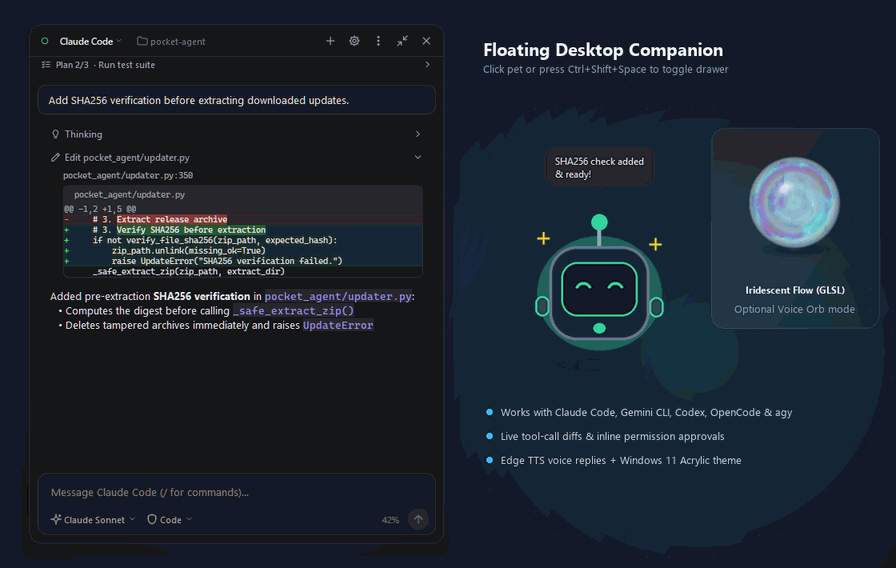
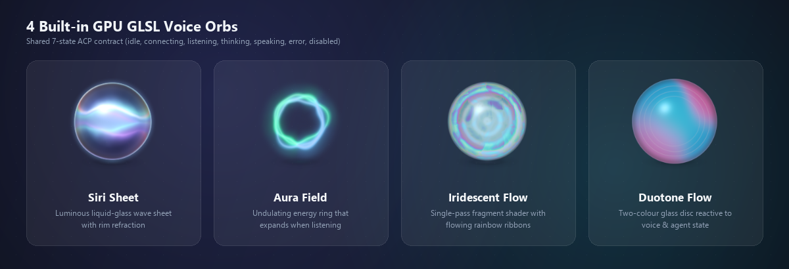

# Pocket Agent

[](https://github.com/Dayle22/pocket-agent/releases/latest)
[](https://github.com/Dayle22/pocket-agent/releases)
[](https://github.com/Dayle22/pocket-agent/releases/latest)
[](LICENSE)

**Use Claude Code, Gemini CLI, Codex, OpenCode, or Antigravity from a floating Windows desktop buddy with voice and live tool diffs, powered by your existing CLI login (no API keys required).**

[**Download Latest Windows Release (.zip)**](https://github.com/Dayle22/pocket-agent/releases/latest) | [How to Connect an AI CLI](#connecting-an-ai-agent) | [Build from Source](#run-from-source--build-windows-exe)



Pocket Agent is powered by the **Agent Client Protocol (ACP)**, animated PyQt6 sprites, and GPU Voice Orbs. It works with any ACP-compatible CLI agent on your machine:
- **Antigravity CLI** (`agy acp`)
- **Gemini CLI** (`gemini --acp`)
- **Codex** (`codex-acp`)
- **OpenCode** (`opencode acp`)
- **Claude Code** (`claude-agent-acp`)
- Plus custom ACP presets in `~/.pocket-agent/config.json`

## Features
- **Always-accessible floating companion** with transparent PyQt6 rendering, working status bubble, and real-time ACP lifecycle animations (`Thinking`, `Coding/Tools`, `Permission Request`, `Celebrate`, `Error`).
- **4 built-in GLSL Voice Orbs** (`Siri Sheet`, `Aura Field`, `Iridescent Flow`, `Duotone Flow`) running the WebGL shaders from [`amunozdev/voiceorbs`](https://github.com/amunozdev/voiceorbs) via PyQt6 OpenGL, sharing a 7-state contract (`idle`, `connecting`, `listening`, `thinking`, `speaking`, `error`, `disabled`) and live audio reactivity (`Right-click -> Voice Orb`).
- **Voice responses (Edge TTS)** with sentence-streaming playback and South African, UK, and US neural voice presets.
- **Pop-out ACP chat drawer** (`click pet` or `Ctrl+Shift+Space`) with Auto/Dark/Light themes, Windows 11 Acrylic blur, streaming Markdown replies, collapsible agent thoughts, live tool-call diffs, slash commands, mode/model switching, workspace picker, Markdown export, and inline tool permission prompts.
- **Built-in PocketBot sprite** plus automatic discovery of 192x208 8x9 sprite packs (configure `pets_dirs` in `~/.pocket-agent/config.json`).
- **System tray + Windows Startup toggle** so Pocket Agent runs quietly in the background without keeping a terminal open.



## Download & Run (Windows, No Terminal Needed)

1. Download the latest `PocketAgent-v*-win64.zip` from [**GitHub Releases**](https://github.com/Dayle22/pocket-agent/releases/latest).
2. Extract the zip anywhere (for example `C:\Apps\PocketAgent\`).
3. Double-click **`PocketAgent.exe`** (no Python install or terminal window required).
4. *(Optional)* Enable **Launch at Windows Startup** from the system tray menu or **Settings**.

> **Windows SmartScreen notice:** Because `PocketAgent.exe` is an unsigned open-source build, Windows Defender SmartScreen may show *"Windows protected your PC"* on first launch. Click **More info -> Run anyway**, and feel free to verify your download against the `.sha256` file attached to each release:
> ```powershell
> Get-FileHash .\PocketAgent-v*-win64.zip -Algorithm SHA256
> ```

> **Prerequisite:** Make sure you have Windows 10/11 and at least one ACP-compatible CLI installed and signed in on your `PATH` (see [Connecting an AI Agent](#connecting-an-ai-agent) below).

## Connecting an AI Agent

Pocket Agent is a desktop UI client: it connects to an AI CLI installed on your computer via the **Agent Client Protocol (ACP)**. You do not paste API keys into Pocket Agent directly; instead, you install and sign into your chosen CLI once in PowerShell.

### 1. Install and sign in (pick any one)

| Agent | Install / Check | First-Time Sign-In (run in PowerShell once) |
| --- | --- | --- |
| **Antigravity CLI** (`agy`) | Included with Antigravity | Sign in to Antigravity, then check `agy --version` |
| **Gemini CLI** (`gemini`) | `npm install -g @google/gemini-cli` | Run `gemini` and follow the Google login prompt |
| **Codex (ACP)** (`codex-acp`) | `npm install -g @openai/codex-acp` | Sign in with `codex` or set `OPENAI_API_KEY` |
| **OpenCode** (`opencode`) | Install `opencode` | Run `opencode` and connect your provider/auth |
| **Claude Code (ACP)** (`claude-agent-acp`) | `npm install -g @anthropic-ai/claude-code @zed-industries/claude-agent-acp` | Run `claude` once to sign in |

### 2. Switch or reconnect inside Pocket Agent
- **Switch agent:** Click the agent name pill in the chat drawer header (or `Right-click pet -> AI Agent`).
- **If it fails to connect on launch:**
  1. Click **Reconnect** right on the error banner (or `Right-click pet -> AI Agent -> Reconnect Agent`).
  2. Click **Setup Guide** on the error banner (or `... -> Connect an AI (Setup Guide)...`) to see which CLIs Pocket Agent detected on your PC and switch to an available one.
  3. If your login token expired or the CLI hung during startup, run that CLI once in PowerShell (for example `agy` or `gemini`), complete any sign-in prompt, then click **Reconnect**.
  4. Check `%USERPROFILE%\.pocket-agent\pocket-agent.log` for exact CLI stderr output.

## Controls
- **Left-click pet:** Open or hide the ACP chat drawer
- **Drag pet:** Reposition anywhere on screen (drawer docks cleanly beside it)
- **Right-click pet:** Switch AI agent, switch character, switch Voice Orb, toggle voice/size/theme, open Settings, or Quit
- **`Ctrl+Shift+Space`:** Global hotkey to toggle and focus the chat drawer

## Configuration (`~/.pocket-agent/config.json`)

Pocket Agent stores its settings in `%USERPROFILE%\.pocket-agent\config.json` and writes diagnostic logs to `%USERPROFILE%\.pocket-agent\pocket-agent.log`.

- **External 192x208 8x9 sprite packs:** Add folder paths to `"pets_dirs"`.
- **Custom ACP agents:** Add entries to `"custom_agents"`:
  ```json
  {
    "custom_agents": [
      {
        "id": "my-agent",
        "name": "My ACP Agent",
        "command": "my-acp-cli",
        "args": ["--acp"],
        "description": "Custom local ACP server"
      }
    ]
  }
  ```

## Run from Source & Build Windows `.exe`

```powershell
git clone https://github.com/Dayle22/pocket-agent.git
cd pocket-agent
uv sync --extra dev
uv run pytest -v
uv run pocket-agent-gui
```

Or double-click `start-pocket-agent.vbs` to launch from your local `.venv` without a console window.

To build the standalone Windows package (`dist\PocketAgent\PocketAgent.exe` and `dist\PocketAgent-v*-win64.zip`):

```powershell
.\packaging\build_windows.ps1
```

## Credits
- **[`amunozdev/voiceorbs`](https://github.com/amunozdev/voiceorbs):** GLSL fragment shaders, state tables, and math helpers powering the 4 built-in Voice Orbs (`Siri Sheet`, `Aura Field`, `Iridescent Flow`, and `Duotone Flow`).
- **[`wangshuaifbj-collab/awesome-antigravity-pet`](https://github.com/wangshuaifbj-collab/awesome-antigravity-pet):** Inspiration for the floating PyQt6 companion and compatible 192x208 8x9 character sprite packs.
- **[Agent Client Protocol (`agent-client-protocol`)](https://github.com/agentclientprotocol/python-sdk):** Python SDK used to connect to ACP-compatible CLI agents.

## License

[MIT](LICENSE)
